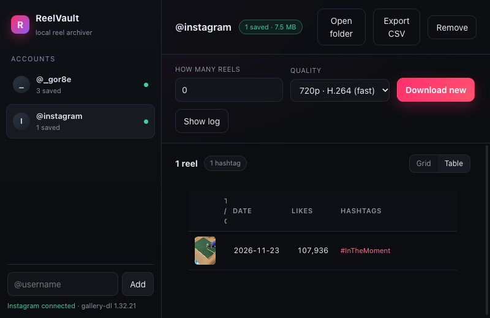

# ReelVault

A local, open-source Instagram **reel archiver** with a real UI. Add any public
account, hit download, and get a clean folder of `.mp4`s plus a searchable
library with titles, captions, hashtags, dates and like counts.

Everything runs on your machine. No cloud, no accounts on our side, no telemetry.



## Features

- **Multiple accounts** — add as many handles as you like; each gets its own
  folder, download archive and library.
- **Grid and table views** — table shows title/caption, date, likes and hashtags.
- **Real metadata** — caption, hashtags, likes, post date and the original IG URL
  are pulled from the post and saved next to each video.
- **Resumable** — downloads are tracked in a per-account archive, so stopping
  mid-way never loses progress and re-runs skip what you already have.
- **720p or 1080p** — 720p uses the fast progressive stream; 1080p goes through
  yt-dlp and merges the DASH video + audio.
- **Readable filenames** — `2026-08-22_223.8k-likes_DcWybFOqvDm.mp4`
  (date, popularity, shortcode), so a plain Finder window stays usable.
- **Live progress + log** — server-sent events stream gallery-dl's output into
  the UI; stop a job at any time.
- **Exports** — `index.csv` per account with every field, plus a thumbnail grid.
- **Post back to Instagram** — select reels (or leave nothing selected for "all
  unposted") and publish them through Instagram's own upload dialog, driven in
  Firefox with your existing login. **Dry run** walks the whole flow and stops
  just before Share. Posting state is tracked per file, so nothing is posted
  twice.
- **Captions that are not filename soup** — a template with `{caption}`,
  `{credit}`, `{hashtags}`, `{likes}`, `{shortcode}` and `{url}`, plus a hashtag
  list that de-duplicates against the original caption. **Preview captions**
  shows exactly what will be published without opening a browser.
- **Session health, not just a cookie** — ReelVault checks whether Instagram
  actually serves the session or redirect-loops it behind a security
  checkpoint, and says so instead of failing with "create button not found".

## Post to Instagram

Merged from [InstaReelPoster](https://github.com/KartBala07/InstaReelPoster).

Posting drives the real Instagram web UI with Selenium inside a clone of your
Firefox profile — no password is stored, and the account is whatever that
session is logged into (the UI shows it before posting).

```bash
python3 -m pip install --user selenium      # Selenium Manager fetches geckodriver
```

1. Log in to Instagram in Firefox (the same session used for scraping).
2. ReelVault clones the profile to `~/.reelvault/firefox-profile` on first use.
3. Pick reels with the checkbox on each tile, or leave nothing selected to queue
   every file that has not been posted yet.
4. Write the caption template and hashtags once — they are remembered in the
   browser — then hit **Preview captions** to read what will actually be
   posted.
5. **Dry run** first, then **Publish** — it asks for confirmation before uploading.
   Every stage is screenshotted into `~/.reelvault/shots/<run>/`.

Captions come from the post's own caption, falling back to a template. Scraped
reels often have an **empty** description, so the default template still credits
the original account and appends your hashtags:

```
{caption}

{credit} {hashtags}      →      "#assettocorsa #fyp #dxt
                                 via @dxt.992 #reels #reelsinstagram"
```

| placeholder | becomes |
| --- | --- |
| `{caption}` | the original caption, or the title when it is empty |
| `{source}` | the account the reel was scraped from |
| `{credit}` | `via @<source>`, empty when unknown |
| `{hashtags}` | your tags, minus any already in the caption |
| `{likes}` `{shortcode}` `{url}` `{date}` | the rest of the metadata |

The same flow runs from a terminal, without the server:

```bash
python3 -m reelvault.post_cli --account dxt.992 --dir ~/.reelvault/data/dxt.992 \
  --files '["2025-08-09_5-likes_DNJXwtch9JN.mp4"]' --tags '#reels #fyp'
# add --publish to actually upload
```

### When Instagram blocks the session

Instagram can gate an account behind a security checkpoint ("Your email may not
be secure → Update email address"). While that is up, **every** request
redirect-loops: downloads fail with `HTTP redirect to home page` and the poster
never finds the create button. ReelVault detects this and shows `Session blocked`
with the reason instead of a mysterious failure.

Clear it once in your own browser (sign in, resolve the prompt), then click
**Import my browser session** — that copies the cookies *and* re-clones the
Firefox profile, so the poster uses the same fresh login as your browser.

## Install

Requires Python 3.9+ and (macOS/Linux) `ffmpeg` on `PATH` for thumbnails and
1080p merging.

```bash
git clone https://github.com/KartBala07/ReelVault.git
cd ReelVault
python3 -m pip install --user gallery-dl yt-dlp
python3 server.py --open          # http://127.0.0.1:8791
```

Optional, for importing cookies from Chrome / Brave / Safari (Firefox works with
no extra deps):

```bash
python3 -m pip install --user cryptography browser-cookie3
```

## Connect Instagram

Instagram serves a logged-out page to everything anonymous, so ReelVault reuses
**the session you already have in your browser** — it never asks for a password.

1. Log in to <https://instagram.com> in Firefox, Safari, Chrome or Brave.
2. In ReelVault click **“Import session from my browser”** in the sidebar.

That copies the Instagram cookies into `~/.reelvault/cookies.txt` (`chmod 600`).
On macOS, macOS may ask for permission to read another app's data — that dialog
is the OS, not ReelVault.

If no session is found it tells you instead of failing silently.

## Use

1. Type a handle (`@thecreator`) in the sidebar and press **Add**.
2. Choose how many reels (`0` = everything) and a quality.
3. **Download new**. Watch the bar, expand **Show log** for raw output.
4. Browse in **Grid** or **Table**, click a reel to play it.
5. **Open folder** to find the files, **Export CSV** for the metadata.

Files land in `~/.reelvault/data/<username>/`.

## How it works

```
web/            vanilla HTML/CSS/JS single-page UI (no build step)
server.py       stdlib HTTP server: JSON API, SSE progress, Range video serving
reelvault/
  ig.py         cookie jar helpers + gallery-dl command construction
  session.py    browser → Netscape cookies.txt import
  jobs.py       one gallery-dl subprocess per job, log fan-out to SSE clients
  library.py    flatten output, derive titles, parse hashtags, scan library
  store.py      SQLite: accounts + jobs
```

Downloads are performed by [gallery-dl](https://github.com/mikf/gallery-dl),
which speaks Instagram's GraphQL with your session. ReelVault adds the UI,
per-account archives, metadata normalisation and the library.

Instagram rate-limits aggressively; ReelVault deliberately paces requests
(~6–11 s between pages). A 1,700-post archive is a multi-hour background job, not
a burst. If you get `429`s, stop and continue later — the archive makes it safe.

## Notes & limits

- **Personal archiving only.** Downloading someone else's posts for backup or
  offline viewing is one thing; republishing them is a copyright problem and
  against Instagram's terms. What you do with the files is on you.
- Accounts that post no captions have no titles or hashtags to pull — the table
  shows the derived filename title and a dash for tags rather than inventing any.
- The cookie file is a live session token. Delete `~/.reelvault/cookies.txt` when
  you're done, and re-import when Instagram invalidates the session.
- The server binds to `127.0.0.1` only.

## License

MIT — see [LICENSE](LICENSE).
